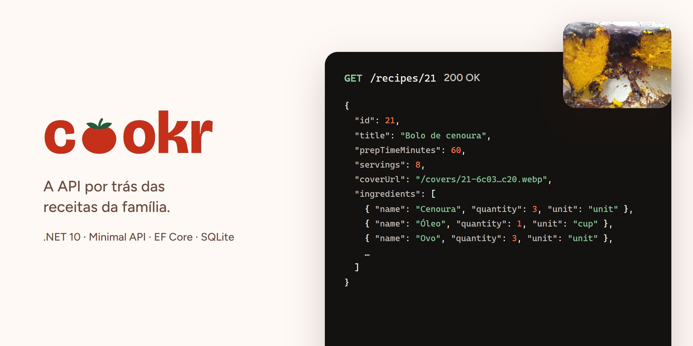

<div align="center">



<sub>Foto: Pedro Toniazzo Terres, CC BY-SA 4.0, via Wikimedia Commons. Créditos de todas as fotos em <a href="src/Cookr.Api/SeedData/covers/CREDITS.md">CREDITS.md</a>.</sub>

# Cookr API

**API REST do Cookr, um app de receitas pessoais.**


</div>

## Rodar

Requer o .NET 10 SDK (versão definida no `global.json`).

```
dotnet run --project src/Cookr.Api
```

> _Em Development, as migrations são aplicadas sozinhas ao subir a API e entram 8 receitas de exemplo com foto (`MigrateAndSeedAsync` no `Program.cs`; créditos das fotos em `src/Cookr.Api/SeedData/covers/CREDITS.md`)._

- API: `http://localhost:5021`
- Scalar: `http://localhost:5021/scalar`

## Testes

```
dotnet test
```

## Estrutura

```
src/
  Cookr.Domain/
  Cookr.Infrastructure/
  Cookr.Api/
tests/
  Cookr.Domain.Tests/
  Cookr.Api.Tests/
```

## Endpoints

<details>
<summary><b>Exemplo: <code>GET /recipes/1</code></b></summary>

```json
{
  "id": 1,
  "title": "Bolo de cenoura",
  "instructions": "Bata cenoura, ovos e óleo no liquidificador...",
  "prepTimeMinutes": 60,
  "servings": 8,
  "coverUrl": "/covers/1-6f1c2a9e0b5d4e7f8a3b2c1d0e9f8a7b.webp",
  "ingredients": [
    { "ingredientId": 1, "name": "Cenoura", "quantity": 3, "unit": "unit" },
    {
      "ingredientId": 3,
      "name": "Farinha de trigo",
      "quantity": 2,
      "unit": "cup"
    }
  ]
}
```

</details>

<details>
<summary><b>Receitas</b></summary>

| Método   | Rota                                       | Ação                                                      |
| -------- | ------------------------------------------ | --------------------------------------------------------- |
| `GET`    | `/recipes`                                 | Lista receitas                                            |
| `GET`    | `/recipes/{id}`                            | Receita com ingredientes                                  |
| `POST`   | `/recipes`                                 | Cria receita com os ingredientes (409 se o título existe) |
| `PUT`    | `/recipes/{id}`                            | Atualiza receita e a lista de ingredientes                |
| `DELETE` | `/recipes/{id}`                            | Remove receita e capa                                     |
| `POST`   | `/recipes/{id}/ingredients`                | Adiciona ingrediente                                      |
| `DELETE` | `/recipes/{id}/ingredients/{ingredientId}` | Remove ingrediente da receita                             |
| `PUT`    | `/recipes/{id}/cover`                      | Envia ou troca a capa (JPEG, PNG ou WebP, até 10 MB)      |
| `DELETE` | `/recipes/{id}/cover`                      | Remove a capa                                             |

</details>

<details>
<summary><b>Ingredientes</b></summary>

| Método   | Rota                | Ação                                       |
| -------- | ------------------- | ------------------------------------------ |
| `GET`    | `/ingredients`      | Lista ingredientes                         |
| `GET`    | `/ingredients/{id}` | Ingrediente por id                         |
| `POST`   | `/ingredients`      | Cria ingrediente                           |
| `PUT`    | `/ingredients/{id}` | Atualiza ingrediente                       |
| `DELETE` | `/ingredients/{id}` | Remove ingrediente (409 se estiver em uso) |

</details>
